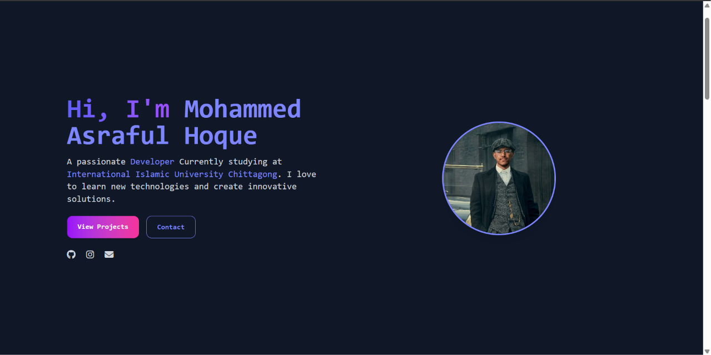

# My-Profile
# Mohammed Ashraful Hoque — Personal Portfolio

A modern, responsive personal portfolio website showcasing my introduction, skills, projects, and contact information. Designed with a clean dark aesthetic, subtle gradients, and a developer-focused layout.

## 🌐 Portfolio Preview



## ✨ Features

- **Modern UI:** Minimal dark-themed design with gradient accents.
- **Responsive Design:** Optimized for different screen sizes and devices.
- **Personal Introduction:** A dedicated hero section with profile picture and introduction.
- **Projects Section:** Showcase of my development projects.
- **Contact Section:** Easy ways to connect with me.
- **Social Links:** Quick access to my GitHub, Instagram, and email.

## 🛠️ Built With

- HTML5
- CSS3
- JavaScript

## 🚀 Getting Started

To run this project locally:

1. Clone the repository:
   ```bash
   git clone YOUR_REPOSITORY_URL
   ```
2. Navigate to the project folder:
   ```bash
   cd YOUR_REPOSITORY_NAME
   ```
3. Open `index.html` in your browser.

## 👨‍💻 About Me

Hi! I'm **Mohammed Ashraful Hoque**, a passionate developer currently studying at International Islamic University Chittagong.

I enjoy learning new technologies, exploring web development, building creative projects, and turning ideas into practical solutions.

## 📬 Connect With Me

- **GitHub:** [Your GitHub Profile](https://github.com/AsrafulHoque23)
- **Instagram:** [Your Instagram](https://www.instagram.com/asraful_mahadi?utm_source=ig_web_button_share_sheet&cplk=ZDNlZDc0MzIxNw==)
- **Email:** asrafulhoquemahadi93@gmail.com

---

⭐ If you like this project, consider giving this repository a star!

*Designed and developed with passion by Mohammed Ashraful Hoque.*
